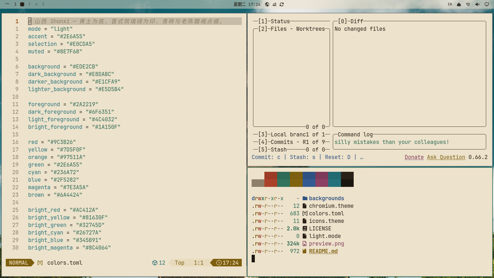

# 山西 Shanxi

黄土为底、晋式琉璃绿为印、青砖与老陈醋褐点缀的浅色主题。壁纸：应县木塔、壶口瀑布、云冈石窟。



## 安装

```bash
omarchy theme install https://github.com/rwanglq-ctrl/omarchy-shanxi-theme
```

## 壁纸来源

1. [应县木塔（仰视）](https://unsplash.com/photos/ancient-wooden-pagoda-and-white-statue-against-blue-sky-AzAMjRk2luU) — X F，Unsplash License（Unsplash）
2. [Hukou Waterfall.jpg](https://commons.wikimedia.org/wiki/File:Hukou_Waterfall.jpg) — Leruswing，CC BY-SA 3.0（Wikimedia Commons）；已裁切、缩放
3. [云冈石窟大佛](https://unsplash.com/photos/a-statue-of-a-person-ONBBzsOCZLM) — Young Kane，Unsplash License（Unsplash）

## 许可

- 壁纸：Wikimedia Commons 照片按各自 CC 许可署名，改编版以 CC BY-SA 4.0 提供；Unsplash 照片依 Unsplash License 使用
- 配色与配置文件：MIT

详见 [LICENSE](LICENSE)。
